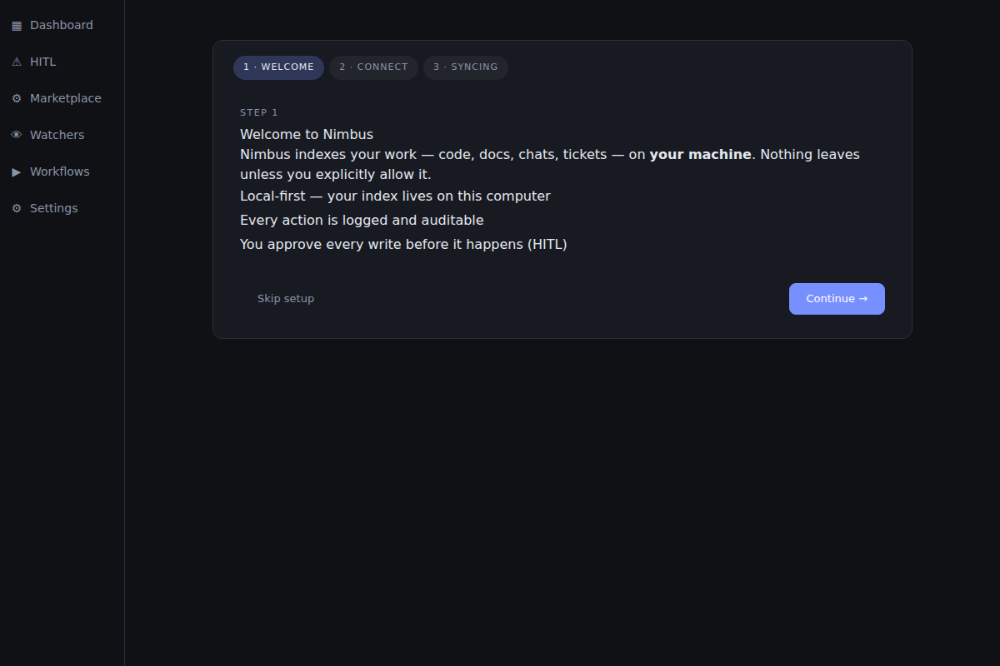
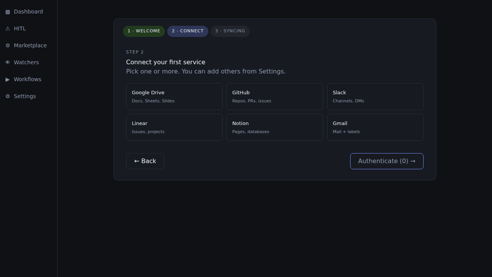
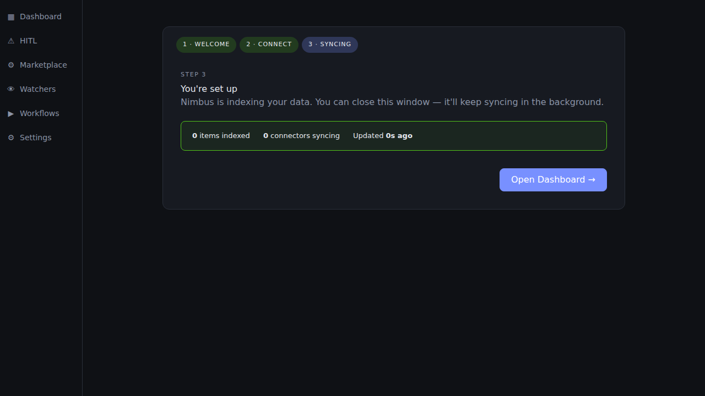
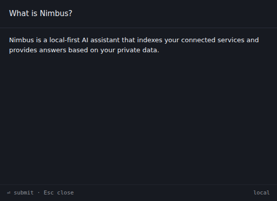

import { Image } from "astro:assets";
import { CardGrid, LinkCard } from "@astrojs/starlight/components";
import onboardingWelcomeImg from "../../../assets/onboarding-welcome.png";

:::caution[The desktop app is not released yet]
No desktop build has shipped, so the onboarding wizard, system tray and Quick Query hotkey
described below cannot be used today. The `nimbus` CLI commands this page names do work now.
First run is the CLI:

```bash
nimbus init                        # starts the Gateway and indexes the current repository
nimbus connector auth github       # connect a service (or google_drive, slack, …)
nimbus ask "what changed this week?"
```

The rest of this page describes the desktop app as it is built, for when it ships.
:::

When you start the Nimbus desktop app for the first time, it launches the
headless Gateway, opens the onboarding wizard, registers a system tray icon,
and optionally binds a global hotkey for Quick Query. This page walks through
each step.

---

## What launches

Starting the Tauri desktop app triggers three things in parallel:

1. **Gateway process.** A headless Bun process starts in the background. It
   creates the local SQLite index, loads your configuration, and opens the
   JSON-RPC IPC socket. The Gateway continues running even when the UI window
   is closed.
2. **Onboarding wizard.** On first launch (no connectors configured), the UI
   opens to the onboarding wizard rather than the dashboard.
3. **System tray icon.** A Nimbus icon appears in the system tray
   (notification area). It shows aggregate connector health and gives you
   one-click access to the UI or Quick Query.

Subsequent launches skip the wizard and go directly to the dashboard.



---

## Onboarding wizard — Welcome

The welcome screen introduces Nimbus and its three core principles:
local-first indexing, structural HITL consent, and vault-only credentials.

Click **Continue** to answer one question, or **Skip setup** to go straight
to the dashboard with no connectors configured (you can add them later via
Settings → Connectors).

<Image src={onboardingWelcomeImg} alt="Onboarding welcome page" />

---

## Onboarding wizard — What do you do?

One card per role pack that ships with Nimbus (for example **Product** and
**DevOps**), then **Engineering**, **Design** and **Something else**.

- A **role pack** sets Nimbus up for that role: which briefs it shows, an
  overnight digest, and which tools it suggests connecting. Picking one opens
  a short summary of the pack, and **Continue** asks for your approval in a
  popup that shows exactly what the pack changes. Decline it and you can carry
  on without the pack. Your own settings always win over a pack.
- **Engineering**, **Design** and **Something else** go straight to the next
  step with general suggestions.

The same question is asked by `nimbus init` in a terminal.

---

## Onboarding wizard — Connect your tools

The connectors shown are the ones your role pack suggests (Product: Slack,
Jira, Notion, Google Drive), or six general ones when you picked no pack.
Each signs in its own way:

| Connector kind | How it signs in |
|---|---|
| Browser sign-in (Slack, Google Drive, Gmail, Notion, …) | Select it, then **Sign in** opens your system browser |
| Jira, Confluence | An inline form: your Atlassian email, an API token and your site URL |
| Token connectors (GitHub, Linear, PagerDuty, …) | The tile shows the `nimbus connector auth <id>` command to run in a terminal; the tile turns green once it is connected |

Nothing moves on by itself: **Continue** is enabled once one connector is
connected, and **Skip for now** is always available.

For the full walkthrough (what scopes are requested, what is indexed,
how to revoke access), see
[Connect your first service](/user-guide/connect-your-first-service/).



---

## Onboarding wizard — Decisions, or Syncing

If your role pack shows **Decisions** (the Product pack does), onboarding ends
on the Decisions screen. While your tools sync and Nimbus looks for decisions
it shows plain progress ("Syncing Slack… 1,240 items", "Looking for decisions…
3 found so far"), and decisions appear as they are found. If it finishes and
finds none, it says what it read ("We read 40 messages from Slack and 120
tickets from Jira…") and why nothing qualified — nothing used decision language,
or the candidates were below your confidence floor — and offers to add a
channel, connect Notion or Google Drive, or widen the window to a year.

Any other answer ends on the syncing screen: a live counter of indexed items.

You do not need to wait. **Open dashboard** is always available; the index keeps
building in the background.



---

## Already set up?

An existing install with no role pack sees a quiet **Try a role pack** card on
the dashboard, once. Pick a pack to set it up, or **Not now** to dismiss it for
good. From a terminal, `nimbus pack list` names the packs you can install.

---

## Skipping onboarding

Desktop app only (the desktop app has not been released yet); from the CLI, add a connector with
`nimbus connector auth <service>`.

If you clicked **Skip** on the welcome page, you land on the dashboard with
no connectors configured. The connector grid shows empty tiles. To add
connectors later:

1. Click **Settings** in the sidebar (or press `S`).
2. Navigate to **Connectors**.
3. Click the connector you want to add and follow the OAuth flow.

---

## System tray

Desktop app only — the desktop app has not been released yet. From a terminal, `nimbus status` and
`nimbus connector list` report the same health.

The Nimbus system tray icon reflects aggregate connector health:

| Colour | Meaning |
|---|---|
| Green | All configured connectors healthy |
| Amber | One or more connectors degraded (stale data, rate-limited) |
| Red | One or more connectors failed or unauthorised |
| Grey | Gateway not running |

**Right-click** the tray icon for the context menu:

- **Open Nimbus** — bring the main window to the foreground.
- **Quick Query** — open the frameless Quick Query popup (same as the hotkey).
- **Connectors** — submenu listing each configured connector; clicking one
  deep-links to its Settings panel.
- **Quit** — stop the Gateway process and exit.


---

## Quick Query (global hotkey)

Desktop app only — the desktop app has not been released yet. From a terminal, use `nimbus ask "<question>"`.

Quick Query is a frameless popup window that lets you ask Nimbus anything
without switching away from your current application.

**Default hotkey:**

| Platform | Hotkey |
|---|---|
| macOS | `Cmd + Shift + N` |
| Windows / Linux | `Ctrl + Shift + N` |

Press the hotkey from anywhere:

1. The Quick Query window appears centred on your primary display.
2. Type your question and press **Enter**.
3. The response streams into the window.
4. The window auto-closes approximately 2 seconds after the stream finishes.
5. Press **Esc** at any time to close immediately.



---

## Hotkey conflicts

If another application has already bound `Ctrl + Shift + N` (or
`Cmd + Shift + N`), the Tauri toolbar shows a banner:

> "Could not register global shortcut Ctrl+Shift+N — another app may be using it."

To resolve this:

- Change the conflicting application's hotkey binding, **or**
- In Nimbus, navigate to **Settings → Advanced** to remap the Quick Query
  hotkey (post-v0.1.0 feature — not available in v0.1.0; for now, adjust the
  conflicting application).

The rest of Nimbus works normally even when the global hotkey cannot be
registered — use the tray icon's **Quick Query** menu item as an alternative.

---

## Where to next

<CardGrid>
  <LinkCard
    title="Connect your first service"
    href="/user-guide/connect-your-first-service/"
    description="Full OAuth walkthrough for Google Drive, GitHub, Slack, and more."
  />
  <LinkCard
    title="Your first query"
    href="/user-guide/your-first-query/"
    description="Run your first query from the CLI."
  />
  <LinkCard
    title="HITL & safety"
    href="/user-guide/hitl-and-safety/"
    description="What actions are gated, what the consent dialog looks like, and how the audit log works."
  />
</CardGrid>
